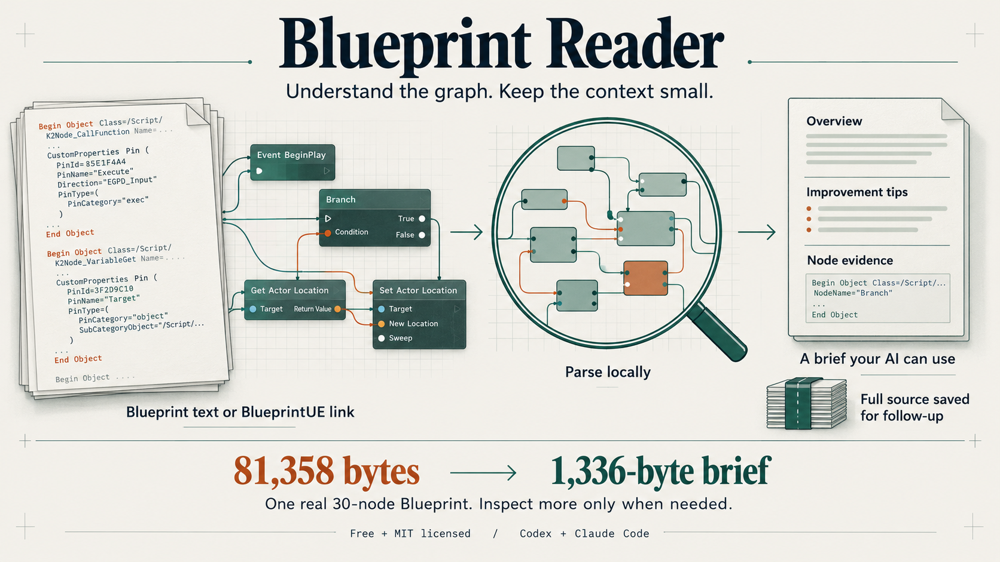

# ue5-mcp

**New: [Blueprint Reader](skills/blueprint-reader/README.md).** Give Codex or Claude Code a BlueprintUE link or raw Unreal clipboard export, then start with a compact brief and inspect the nodes that matter. Free, local and MIT licensed.

**[Try Blueprint Reader in your browser →](https://ibrews.github.io/ue5-mcp/)** No installation or account. Paste raw text, add files, reopen a saved session, or import a BlueprintUE link automatically. Parsing stays in your browser; link imports use our small fetch helper. Pasted text and files are never uploaded.

[](skills/blueprint-reader/README.md)

The illustration shows the workflow. The numbers come from [this public graph](https://blueprintue.com/blueprint/6v52d8no/), checked with reader 0.2.2. The brief summarizes and omits detail; a saved session retains the original source for follow-up. Byte counts are not token counts.

[Open the live reader](https://ibrews.github.io/ue5-mcp/) · [Install the agent skill](skills/blueprint-reader/README.md#1-install-once) · [Share the reader](docs/blueprint-reader-launch.md)

## Live editor field manual

A field manual for AI agents driving Unreal Engine 5 through MCP.

When an AI agent connects to the UE5 editor through an MCP server, it gains access to tools for manipulating Blueprints, materials, Niagara particles, MetaSound audio, meshes, widgets, levels — anything UE's reflection surface exposes. The tools are powerful but UE is full of undocumented quirks: APIs that silently no-op, crash patterns that only surface at runtime, render paths that compile cleanly but produce nothing visible, async operations that don't block, and reflection rules that bite anyone who treats the engine like a typical scripting target.

This skill gives your AI that knowledge upfront so it doesn't have to rediscover it every session.

**The skill is server-agnostic.** It works with any MCP server that exposes UE5 functionality — including Epic's official `ModelContextProtocol` plugin (experimental, ships with UE 5.8), and any third-party / custom server. It documents *engine-level* behaviour, not server-level features. Server-specific tool names and shapes vary; use `tools/list` against your own server to discover what's actually available.

## What's inside

- **UE5 reflection gotchas** — PascalCase vs snake_case silent no-ops, Blueprint class path `_C` suffix, async asset operations, `PostEditChangeProperty` requirement, three-step graph mutation
- **Crash patterns** — referenced-mesh deletion, rapid actor ops, MetaSound scalar-to-audio-pin, save-before-PIE for Niagara/MetaSound
- **Subsystem-specific knowledge** — Lumen mobility, Blueprint instance override staleness, Niagara create-from-empty / `script_usage` / dynamic input limitations, MetaSound pin exactness, material emissive bloom threshold + translucent shading, UMG `CreateWidget` owner context, in-world widget components, AudioComponent reflection name
- **Python ↔ MCP data channel** — Actor Tags workaround for Python `print()` output that goes to the UE log instead of back to MCP
- **MCP transport requirements** — Accept header, image content blocks, cancellation semantics, sessions
- **Patterns for MCP server authors and clients** — schema-in-error, output-schema authority, continuation tokens, `FScopedTransaction`, verify-after-mutate, recursion caps
- **UE 5.7 vs 5.8 differences** — engine-level deltas that affect any agent
- **Asset structure quick reference** — what fields appear in Blueprint, Niagara, Material, Level, Sequencer, and Widget Blueprint dumps

## Installation

### Blueprint Reader for Codex and Claude

[Blueprint Reader](skills/blueprint-reader/README.md) turns BlueprintUE links and raw Unreal clipboard exports into a short AI brief, an overview, and improvement tips with exact node evidence. Paste a whole graph plus its macros into the local page, keep the full source in a saved session, and inspect individual entries or nodes when needed. No Unreal editor, MCP connection or AI API key is required.

With **Git and Node.js 20+**, run in Terminal on macOS/Linux:

```bash
git clone https://github.com/ibrews/ue5-mcp.git
cd ue5-mcp/skills/blueprint-reader
npm ci --ignore-scripts --no-audit --no-fund
node scripts/install-skill.mjs both
```

The installer uses `~/.agents/skills/blueprint-reader` for Codex and `~/.claude/skills/blueprint-reader` for Claude Code. Use `codex` or `claude` instead of `both` for a single client. Open a new agent session after installation.

| Client | First prompt |
|---|---|
| Codex | `Use $blueprint-reader to explain https://blueprintue.com/blueprint/6v52d8no/ and identify missing context.` |
| Claude Code | `/blueprint-reader Explain https://blueprintue.com/blueprint/6v52d8no/ and identify missing context.` |
| Any chat client | Run `npm start`, open the printed local URL, ingest a graph and use **Copy AI brief**. |

**Windows:** clone and install on a non-system data drive; the installer creates skill-discovery junctions. **Upgrading an existing install:** preserve/move the old copy first; the installer refuses overwrites and duplicate legacy Codex installs. Follow the [complete getting-started and update guide](skills/blueprint-reader/README.md) for platform-specific commands, saved sessions, troubleshooting, testing and limits.

The core and local page are free and [MIT licensed](LICENSE). Education, review clinics and hands-on support are the intended paid offering; no membership is required to use the reader.

### Live editor field manual

The following installation options concern the repository's original Unreal editor field manual. The reader's local Node setup is described above.

### Claude Code

```bash
git clone https://github.com/ibrews/ue5-mcp.git ~/.claude/skills/ue5-mcp
```

The skill auto-triggers when UE5 MCP tools are detected, or when the user mentions Unreal Engine, UE5, Blueprints, Niagara, MetaSound, materials, or any UE editor automation workflow.

### Cowork (manual upload)

1. [Download this repo as a ZIP](https://github.com/ibrews/ue5-mcp/archive/refs/heads/main.zip)
2. In Claude desktop: **Customize → Skills → "+" → Upload a skill** → select the zip.

### As a plugin (auto-updates from GitHub)

```
/plugin marketplace add ibrews/ue5-mcp
/plugin install ue5-mcp@ibrews-ue5-mcp
```

Works in Claude Code and Cowork. Updates automatically when changes push to this repo.

### Other AI agents

The `SKILL.md` file uses Claude's skill format (YAML frontmatter + markdown), but the content is universal. Feed it into your agent's system prompt or knowledge base. Strip the frontmatter if your framework doesn't understand it — the knowledge sections stand on their own.

## Requirements

- Unreal Engine 5.x (this skill covers 5.7 and 5.8 specifically; most content applies to earlier and later versions)
- An MCP server exposing UE5 functionality. Options:
  - **[Epic's official `ModelContextProtocol` plugin](https://dev.epicgames.com/documentation/en-us/unreal-engine)** — experimental, ships with UE 5.8, requires a source build of the engine.
  - **Third-party / custom MCP servers** — the community ecosystem is growing; any MCP server that talks to a running UE5 editor works.
- An AI agent that speaks MCP (Claude Desktop, Cursor, VS Code's MCP UI, Epic's EDA panel, OpenClaw, or any MCP-compatible agent).
- Optional: Pixel Streaming plugin (for visual verification and PIE input).
- Optional: Python Editor Script Plugin (for advanced scripting, required for the Python data-channel pattern).

## How it works

The skill is a single `SKILL.md` file. When loaded, it gives your AI agent context about:

1. **What will silently fail** — APIs that compile clean but no-op, produce no results, or corrupt assets without complaint.
2. **What will crash the editor** — actions that trigger asserts and revert your unsaved work.
3. **What actually works** — call sequences with exact ordering, parameter formats, and the verification steps that matter.

The knowledge is organised by topic (reflection rules, stability hazards, subsystems, transport, patterns) so the agent can quickly find relevant guidance for whatever it's working on.

## Things to Try

For the Blueprint reader: paste a BlueprintUE link into either assistant and ask what it does; provide a main graph plus named macro exports and ask it to trace an input event; then ask for an edit plan with exact node IDs, pin names and an Unreal test. The reader's own CLI can verify each result using `--brief`, `--entry ... --format flow`, and `--node ...`.

1. **Ask your agent to create a new Blueprint Actor** — with an MCP server connected, the Blueprint appears in the Content Browser within seconds; no manual editor clicking required. Then ask it to verify the asset exists by reading it back.
2. **Ask your agent to create a Niagara particle system** — the skill steers it away from "create from empty" (which compiles but doesn't emit) and toward duplicating a working template. You should see particles in PIE.
3. **Ask your agent to wire an Audio Component playing a MetaSound** — the skill warns about the Multiply-into-Audio-pin crash and provides the safe wiring pattern.
4. **Ask your agent to batch-edit assets via Python** — the skill describes the Actor Tags data channel workaround so script output flows back to the agent correctly.
5. **Ask your agent what to do before deleting a mesh asset** — it should walk the dependency graph first, confirm nothing references the mesh, and only then delete.

## Contributing

This is a living document. If you discover new UE5 quirks, crash patterns, reflection rules, or workarounds, open a PR or issue. The kind of knowledge that belongs here is what you'd never find in official docs — things that only surface after hitting a wall and debugging through.

Especially welcome:

- Blueprint Reader parser fixes, cross-platform installation reports, and small reproducible clipboard fixtures you have permission to share

- New subsystem coverage (Sequencer, Control Rig, PCG, Geometry Script, Animation Blueprint, Sound Cue, Landscape, etc.)
- Corrections to existing patterns that no longer apply after newer UE5 releases
- Platform-specific gotchas (Linux editor builds, console targets, macOS)
- Engine-level differences in newer UE5 versions (5.9+) as they ship

PRs that add server-specific tool catalogues, recipes tied to a single MCP server, or framing that promotes one server over another are out of scope. This skill stays server-agnostic so it's useful regardless of which UE5 MCP setup you're running.

## Origin

Built during real UE5 development sessions using AI agents driving the editor. Every entry traces back to an actual failure, runtime crash, or hours-long debugging session.

## License

[MIT](LICENSE) — Copyright (c) 2026 Alex Coulombe Presents. Blueprint Reader includes its own copy of the license so standalone skill installations retain the notice. Third-party packages keep their original licenses; see [reader provenance](skills/blueprint-reader/references/format.md).

## Support

If you like seeing this kind of thing get built and shared, [donations are always welcome](https://www.alexcoulombepresents.com/support) — they buy hardware, render time, and the freedom to keep giving most of this away.
