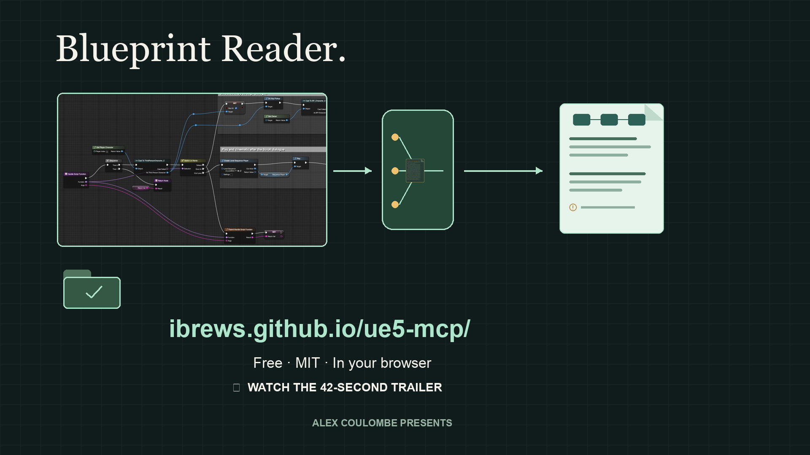

# Blueprint Reader

**[Open Blueprint Reader in your browser →](https://ibrews.github.io/ue5-mcp/)** Free, no account or installation.

Read an Unreal Blueprint without pasting thousands of lines into chat. Start with a BlueprintUE link, copied nodes or text files containing a graph and its macros. Get a short brief, a plain-language overview, missing dependencies and improvement tips tied to specific nodes.

The reader runs locally and never edits your Blueprint assets. You do not need Unreal, an MCP server or an AI API key. The parser, CLI, local page and agent skill are free under the [MIT license](LICENSE).

[](https://ibrews.github.io/ue5-mcp/trailer/)

**[Watch the trailer](https://ibrews.github.io/ue5-mcp/trailer/)** · Real nodes and an actual link import, with motion showing source overload → compact brief → focused inspection. Clarifying captions and original music. [Transcript](../../docs/trailer/README.md#transcript).

Sharing the reader or trailer URL uses the custom social card. Both pages include the matching favicon; [brand assets and provenance](assets/branding/README.md) are included in the repository.

**A real example:** [this public 30-node graph](https://blueprintue.com/blueprint/6v52d8no/) produced a 1,336-byte brief from 81,358 bytes of source with reader 0.2.2. This is a summary, not lossless compression or a token-count guarantee. Save the full session and inspect specific nodes when you need more detail.

## Try it without installing anything

Open the [live browser edition](https://ibrews.github.io/ue5-mcp/) and click **Try a sample graph**, or paste your own Blueprint clipboard text. **Read Blueprint** stays neutral and disabled until the active input contains recognizable complete Blueprint text, a valid BlueprintUE link, or supported files/session contents. It turns green when ready; full syntax checking happens when you read the graph. You can also add text files and macros, reopen a `.bp-session.json`, inspect exact nodes and entry paths, and download the brief, findings or full session.

**BlueprintUE links:** choose **BlueprintUE link**, paste a public or unlisted URL, and click **Read Blueprint**. Our fetch helper retrieves the export automatically; your browser parses it and produces the report. The source URL stays with the saved session. If a link is private, expired, blocked, or too large, use **Open BlueprintUE**, copy its **Code to copy** text, then choose **Use copied text instead**.

Parsing, analysis and source hashing run in a browser worker. Pasted text and files are never uploaded. For a link import, our Vercel helper receives the URL and retrieves its export from BlueprintUE; it extracts text but does not analyze graphs, call AI, save exports or cache responses. GitHub Pages and Vercel's ordinary access logging still applies, so use paste/files for sensitive source. There are no analytics or external fonts. Automatic imports allow up to 4 MiB of JSON response; paste/files allow 32 MiB of decoded text. Save the full session before closing or reloading: data is kept in tab memory, not automatically stored.

## Native editor graph JSON

Paste or upload a complete `dump_blueprint_graph` result to get the same compact
brief, findings and focused node inspection. Raw payloads and complete MCP
envelopes work. Truncated responses are rejected; retrieve every continuation
chunk first. Older dumps import with an explicit warning about missing hidden
pins and semantic metadata.

With a supporting editor bridge, `include_clipboard:true` captures both native
JSON and original Unreal clipboard text for each graph. Run
`node scripts/native-parity.mjs paired-dump.json` to compare their node/pin IDs,
wires and selected defaults. This is a comparison of the **same loaded graph**,
not proof of saved `.uasset` parity or runtime correctness. Native node `--format
raw` output is JSON and cannot be pasted back into Unreal. See
[the editor workflow](references/editor-integration.md).

Validated on four real Blueprints loaded in UE 5.8.4: 8 graphs, 170 nodes, 551
pins and 136 wires match their paired clipboard exports. Graph defects remain
visible even when both representations agree. See [validation results and
limits](references/native-validation.md).

## 1. Install once

You need **Git** and **Node.js 20 or newer** (`node --version`). The commands below install the same reader for Codex and Claude Code. Run them in your terminal, not inside a chat message.

### macOS and Linux

```bash
git clone https://github.com/ibrews/ue5-mcp.git
cd ue5-mcp/skills/blueprint-reader
npm ci --ignore-scripts --no-audit --no-fund
node scripts/install-skill.mjs both
```

If you already cloned the repository, use that checkout and start at `cd skills/blueprint-reader` from its root. If the skill is already installed, follow the update section below.

### Windows (PowerShell)

Choose an existing **non-system data drive**. This example uses `D:`; substitute your own drive if needed. The installer deliberately refuses a source checkout on the Windows system drive.

```powershell
New-Item -ItemType Directory -Force D:\GitHub | Out-Null
Set-Location D:\GitHub
git clone https://github.com/ibrews/ue5-mcp.git
Set-Location D:\GitHub\ue5-mcp\skills\blueprint-reader
npm ci --ignore-scripts --no-audit --no-fund --cache D:\Caches\npm
node scripts/install-skill.mjs both
```

Windows installations use directory junctions: the client discovers the skill in your profile, while the files and dependencies stay in the data-drive checkout. Keep that checkout at the same path. macOS/Linux installations are independent copies.

If your machine has only a system drive and your storage policy permits it, explicitly add `--allow-system-drive` to the install command. The default still requires a non-system Windows drive. This changes only the install location check.

### Choose your client

| Install command | Skill location |
|---|---|
| `node scripts/install-skill.mjs codex` | `~/.agents/skills/blueprint-reader` |
| `node scripts/install-skill.mjs claude` | `~/.claude/skills/blueprint-reader` |
| `node scripts/install-skill.mjs both` | Both locations above |

`~` means your user profile directory. These locations follow the [Codex local-skill documentation](https://developers.openai.com/codex/skills/) and [Claude Code personal-skill documentation](https://code.claude.com/docs/en/skills). Claude Code's local installation does not install the reader into Cowork or a cloud chat environment.

If `CLAUDE_CONFIG_DIR` is set, the installer uses its `skills/blueprint-reader` directory. Codex continues to use `~/.agents/skills`; the legacy duplicate check also respects `CODEX_HOME`. Version 0.2.2 fixes command startup through Windows junctions and directory symlinks.

## 2. Try it in Codex or Claude Code

Open a new local session after installing. The agent needs permission to run local Node commands and read your input files.

**Codex:** select the skill or paste:

```text
Use $blueprint-reader to explain https://blueprintue.com/blueprint/6v52d8no/.
Start with a compact brief, identify missing context, then trace the main entry.
```

**Claude Code:** invoke:

```text
/blueprint-reader Explain https://blueprintue.com/blueprint/6v52d8no/.
Start with a compact brief, identify missing context, then trace the main entry.
```

For your own files, give the agent absolute paths to the main graph and macro exports. Ask for an explanation first, then an edit plan with graph/node IDs, pin names and an Unreal test. Keep the raw export on disk so the agent can inspect only the details it needs.

## 3. Use the paste/link page

From the repository's `skills/blueprint-reader` directory:

```bash
npm start
```

Open the `http://127.0.0.1:PORT` address printed in the terminal. Paste clipboard text, choose text files, reopen a saved session, or enter a public/unlisted BlueprintUE link. Use **Read Blueprint**, then **Copy AI brief**. This also works with a chat-only assistant: paste the brief into chat and request additional node/entry details from the local page when needed.

The overview comes from visible nodes and types; it is a starting point for interpretation. Improvement tips include evidence and a suggested test. **Explore** traces entry points or inspects an exact node ID. **Save full local session** preserves original text for later inspection. Saved sessions can contain private project data; share them only intentionally.

The page uses no external fonts, analytics, uploads or model calls. Link ingestion contacts BlueprintUE. One successful ingestion replaces the server's previous session; a failed parse preserves it. Press **Ctrl+C** in the terminal to stop the server and clear its in-memory session. Saved files remain on disk.

<details>
<summary>See the actual local page with a public BlueprintUE graph</summary>


Captured from reader 0.2.2 on 2026-10-21 using Nicola's public [Extended dialogue system](https://blueprintue.com/blueprint/6v52d8no/) export. This graph has no matches for the reader's supported improvement checks, and its missing ForEachLoop body is reported. The screenshot is a real app capture; the graphic above is a workflow illustration.

</details>

### Is there a hosted web app?

Yes: **[ibrews.github.io/ue5-mcp](https://ibrews.github.io/ue5-mcp/)** is the browser edition. A `127.0.0.1` address still points to the optional local Node page on your own computer; it is not a shareable address.

Both interfaces share the parser, reports and saved-session format. The Pages edition uses a Web Worker and Web Crypto for local parsing, plus a narrowly scoped hosted helper for automatic BlueprintUE imports. The local Node page fetches those links directly. See the [browser and helper deployment guide](references/browser-edition.md).

## Things to Try

For a no-install start, [open the live reader](https://ibrews.github.io/ue5-mcp/) and choose **Try a sample graph**. Its two branch outcomes deliberately enter the same destination; use **Inspect evidence** to see the exact pins.

Run these from the reader directory:

1. **Check a real graph.** The public example currently contains 30 nodes and 107 pins; its missing engine macro body is reported explicitly.

   ```bash
   node scripts/read-blueprint.mjs "https://blueprintue.com/blueprint/6v52d8no/"
   ```

2. **Read your graph with its macros.** Copy nodes in Unreal and save them as plain text; use separate files or clear graph headings. Substitute your real paths.

   ```bash
   node scripts/read-blueprint.mjs "main.txt" "macro.txt" --save-session camera.bp-session.json
   ```

3. **Ask a focused follow-up without refetching.** Use the graph and entry IDs printed in your brief.

   ```bash
   node scripts/read-blueprint.mjs --session camera.bp-session.json --budget 4000
   node scripts/read-blueprint.mjs --session camera.bp-session.json --graph s1:g1 --entry K2Node_Event_0 --format flow
   node scripts/read-blueprint.mjs --session camera.bp-session.json --graph s1:g1 --node K2Node_CallFunction_3
   ```

4. **Save complete findings for review.** This JSON can be much larger than the brief; keep it on disk and inspect relevant parts.

   ```bash
   node scripts/read-blueprint.mjs --session camera.bp-session.json --format analysis --output findings.json
   ```

Output/session writes refuse to overwrite files. Choose a new filename if one already exists. The default brief cap is 8,000 UTF-8 bytes, configurable with `--budget` from 2,000 to 64,000. Byte counts are not token counts. Omissions are explicit, and full source remains in the input or saved session. `--format summary` provides the older detailed inventory; `--help` lists all formats and selectors.

## Updating or moving an installation

Update the source checkout with `git pull --ff-only`, then run `npm ci --ignore-scripts --no-audit --no-fund` in the reader directory (retain your data-drive npm cache on Windows).

- **Windows junctions:** updating the same checkout updates both discovered skills. You do not need to rerun the installer. If migrating an older Codex junction from `.codex/skills` to `.agents/skills`, move the old junction outside all skill folders first, then install the Codex target. Move the junction itself; preserve its source checkout.
- **macOS/Linux copies:** move the existing `blueprint-reader` installation outside the client's skills folder, then rerun the installer for that client. Keep the backup until the new version works. Do not put a backup under another name inside `skills`, where the agent may still discover it.
- **Older Codex installs:** versions before 0.2.1 used `~/.codex/skills/blueprint-reader`. The current installer detects that location and asks you to move it aside before creating `~/.agents/skills/blueprint-reader`. This avoids two copies of the same skill.

For example, to update a single existing Codex copy on macOS/Linux:

```bash
mkdir -p "$HOME/.codex/skill-backups"
mv "$HOME/.agents/skills/blueprint-reader" "$HOME/.codex/skill-backups/blueprint-reader-before-update"
node scripts/install-skill.mjs codex
```

For a legacy copy, use its `.codex/skills/blueprint-reader` path as the `mv` source. Choose an unused backup name; do not overwrite an earlier backup. For Claude, use `.claude/skills/blueprint-reader` and the `claude` installer target. Restart the client session after an update.

## Troubleshooting and limits

| Symptom | Next step |
|---|---|
| Skill not listed | Start a new local session. Check for `SKILL.md` at the destination printed by the installer. Avoid duplicate legacy/current copies. |
| Node or a package is missing | Install Node 20+, then rerun `npm ci` from the reader directory. |
| Already installed / legacy installation found | Follow the update procedure above; no existing files are replaced automatically. |
| BlueprintUE link fails | The paste may be private, expired or unavailable. Use copied Blueprint text instead. |
| Duplicate node names | Supply distinct graphs in separate files or under headings; names are graph scoped. |
| Missing macro warnings | Provide the macro bodies alongside the main graph. Engine macros and project macros are listed separately. |
| RTF input | The CLI converts RTF on macOS using `textutil`; the browser and other platforms need plain text. |
| Saved-session link expired | Another ingestion replaced it or the server restarted. Reopen the saved session or original input. |

UTF-8 and UTF-16 with BOM, Markdown headings, concatenated clipboard exports and BPGraph wrappers are supported. Binary `.uasset` files are not. Combined decoded text is limited to 32 MiB and 100 sources; workers have memory/time limits. `--strict` exits 2 for incomplete or invalid connections. Parsing is static evidence, not an Unreal compile or runtime test. The reader does not infer missing external function bodies or guarantee that its supported improvement checks find every issue.

## Testing and contributing

```bash
npm test
npm run test:live
```

The suite includes 102 real UEBlueprint node exports. The opt-in live suite fetches the public dialogue example, which can change or disappear. `BLUEPRINT_ACCEPTANCE_FILE` enables an additional private camera-sample test used during development; contributors do not need that private file to run the normal suite. See [format and provenance](references/format.md) for schema details and recorded platform validation.

**Binary asset evaluation:** [UnrealBPInspect v1.1.1 testing](references/unrealbpinspect-evaluation.md) found package-header failures in ten of twelve real UE 5.6–5.8 assets. Two early 5.6 assets using an older layout decoded, but same-asset clipboard parity is still unverified. Binary import remains unsupported. The linked report includes a repeatable local evaluation harness and the gates for a future adapter.

Issues and PRs are welcome. Include the OS, Node version, command, observed error and a small export you have permission to share. Keep client assets, secrets and private project exports out of public issues and commits. Preserve exact node/pin identity and add a regression case for parser fixes.

## License and support

Copyright (c) 2026 Alex Coulombe Presents. Released under the [MIT license](LICENSE), including commercial use under its terms. This is a source installation, not a published npm package; `private: true` in package.json prevents accidental npm publishing and does not restrict source access.

UEBlueprint, htmlparser2, entities and their dependencies retain their own licenses and notices in `node_modules`. The installer preserves those directories and includes this project's license. See [provenance](references/format.md) for the parser and interface attribution.

The core reader and local page are free. Paid education, worked examples, review clinics and hands-on support are the intended complementary offering; no paid tier is needed to use this tool. No pricing or commercial service launch is announced here. [Support the work](https://www.alexcoulombepresents.com/support).
